# 📘 PANDUAN STANDAR OPERASIONAL PROSEDUR & CARA KERJA SISTEM APLIKASIKITA
**Platform Tata Kelola Portofolio Kredit, Tata Arsip Khazanah & Manajemen Server Mandiri Unit Kerja**  
*Versi Rilis:* `AplikasiKita-v3.1.12 Vanguard (Build #20261103)` | *Arsitektur:* Mini PC Linux (*Offline-First*)

---

> [!NOTE]
> **Pernyataan Privasi & Sanitasi Data**: Seluruh tangkapan layar, nomor rekening, nama nasabah, dan dokumen dalam buku panduan ini telah disanitasi secara ketat menggunakan data simulasi/dummy realistis. Tidak ada nomor rekening riil, nama debitur aktual, atau kode kantor unit operasional yang dipublikasikan.

---

## 📑 DAFTAR ISI
1. [BAB I • PENDAHULUAN & ARSITEKTUR SISTEM](#bab-i--pendahuluan--arsitektur-sistem)
2. [BAB II • MATRIKS HAK AKSES & PERAN PENGGUNA](#bab-ii--matriks-hak-akses--peran-pengguna)
3. [BAB III • SOP PENCARIAN, PEMINJAMAN & PENGEMBALIAN BERKAS (CARIBERKAS)](#bab-iii--sop-pencarian-peminjaman--pengembalian-berkas-cariberkas)
4. [BAB IV • SOP PEMINDAIAN DOKUMEN FISIK & REGISTRASI LEMARI KHAZANAH (SCANNER)](#bab-iv--sop-pemindaian-dokumen-fisik--registrasi-lemari-khazanah-scanner)
5. [BAB V • SOP TATA KELOLA DOKUMEN LUNAS PUTUS](#bab-v--sop-tata-kelola-dokumen-lunas-putus)
6. [BAB VI • SOP MONITORING PORTOFOLIO KREDIT & PENAGIHAN HARIAN](#bab-vi--sop-monitoring-portofolio-kredit--penagihan-harian)
7. [BAB VII • SOP AUDIT SPASIAL LEMARI & STOCK OPNAME KHAZANAH](#bab-vii--sop-audit-spasial-lemari--stock-opname-khazanah)
8. [BAB VIII • SOP KONTROL SERVER MINI PC, PENCADANGAN CLOUD & KEAMANAN LAN](#bab-viii--sop-kontrol-server-mini-pc-pencadangan-cloud--keamanan-lan)
9. [BAB IX • PANDUAN PENANGANAN KENDALA (TROUBLESHOOTING FAQ)](#bab-ix--panduan-penanganan-kendala-troubleshooting-faq)

---

## BAB I • PENDAHULUAN & ARSITEKTUR SISTEM

### 1.1 Latar Belakang & Arsitektur Mandiri
Platform **AplikasiKita** dibangun untuk menjawab kebutuhan modernisasi tata kelola operasional kantor unit kerja perbankan. Sistem ini mengintegrasikan manajemen portofolio pinjaman, penataan berkas fisik jaminan di ruang khazanah, digitalisasi arsip pinjaman (Brimen), pencetakan thermal POS58 USB otomatis, dan pemantauan infrastruktur server dalam satu ekosistem terpadu.

### 1.2 Filosofi *Offline-First*
Sistem beroperasi langsung di perangkat **Mini PC** yang terpasang pada jaringan LAN internal kantor unit. Seluruh proses bisnis inti—seperti pencarian lokasi berkas di lemari, otorisasi peminjaman dokumen, pemindaian digital berkas jaminan, verifikasi status pelunasan kredit, dan pencetakan tanda terima—dapat beroperasi 100% mandiri tanpa ketergantungan koneksi internet publik.

### 1.3 Siklus Data Portofolio Harian Data Center (`/import`)
Setiap pagi sebelum operasional kantor dimulai, petugas Administrator atau Brimen melakukan pembaruan data portofolio harian melalui modul impor. Modul ini memproses data nominatif resmi untuk menyelaraskan baki debet, status kolektibilitas, jadwal angsuran, proyeksi runoff/PTP, dan mendeteksi pelunasan kredit secara otomatis.

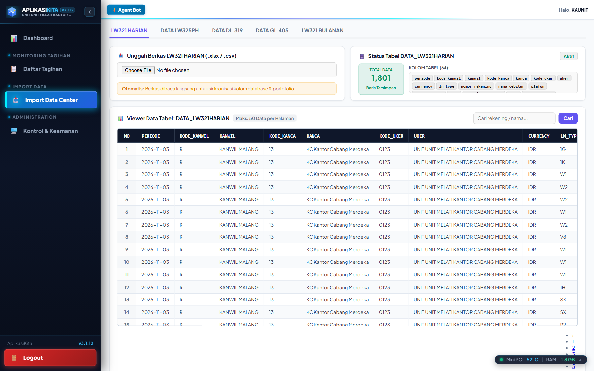
*Gambar 1.1: Modul Impor Data Portofolio Harian Data Center (Sinkronisasi Data Nominatif & Deteksi Pelunasan Harian).*

---

## BAB II • MATRIKS HAK AKSES & PERAN PENGGUNA

Sistem menerapkan prinsip *Role-Based Access Control* (RBAC) dengan pemisahan tugas (*Segregation of Duties*) untuk memastikan keamanan operasional dan integritas data:

| Peran Pengguna | Kode Akun | Ruang Lingkup Otoritas | Modul Utama yang Diakses |
| :--- | :---: | :--- | :--- |
| **Kepala Unit** | `kaunit` | Pengawasan manajerial menyeluruh, persetujuan otorisasi berkas, audit portofolio, evaluasi KPI mantri, dan kontrol server unit. | Dashboard Eksekutif, Cari Berkas, Scanner Jaminan, Lunas Putus, Tagihan Harian, Monitoring Lemari, Server Control. |
| **Petugas Brimen / Arsip** | `brimen` | Pengelolaan tata arsip fisik ruang khazanah, pemindaian dokumen jaminan, penataan koordinat lemari/boks, dan eksekusi lunas putus. | Cari Berkas, Scanner Jaminan, Dokumen Lunas Putus, Monitoring Lemari, Registrasi Agunan Fisik. |
| **Mantri / Tenaga Pemasar** | `mantri` | Monitoring debitur kelolaan masing-masing, peminjaman berkas untuk penagihan, eksekusi PTP, dan pemantauan jatuh tempo runoff. | Tagihan Harian, Monitoring Debitur, Pengajuan Peminjaman Berkas, Simulasi Restrukturisasi. |
| **Customer Service / Teller** | `cs` / `teller` | Pengecekan kelengkapan berkas saat pelunasan, verifikasi posisi dokumen agunan asli sebelum diterbitkan ke nasabah. | Cari Berkas (Read-Only Status Lemari), Dokumen Lunas Putus (Status Verifikasi CIF). |
| **Administrator Sistem** | `admin` | Pemeliharaan teknis sistem Mini PC, konfigurasi rclone cloud backup, pengawasan hardware, dan mitigasi whitelist keamanan LAN. | Seluruh modul sistem, Pusat Kontrol Server, Firewall LAN, Terminal Artisan, Rclone Backup. |

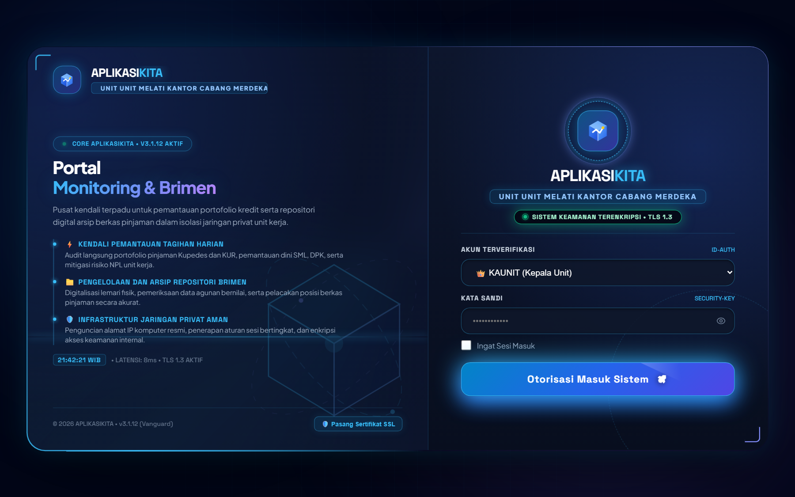
*Gambar 2.1: Portal Login Multi-Peran Terpadu dengan Pengalihan Dinamis Berdasarkan Otoritas Pengguna.*

---

## BAB III • SOP PENCARIAN, PEMINJAMAN & PENGEMBALIAN BERKAS (CARIBERKAS)

Modul **Cari Berkas (`/cariberkas`)** adalah instrumen utama untuk melacak keberadaan fisik dokumen kredit dan sertifikat jaminan di ruang khazanah unit kerja secara presisi.

```
[Ketik Nomor Rekening / Nama Debitur]
                  ↓
        [Pencarian Multi-Kriteria]
                  ↓
        [Tinjau Panel Inspeksi 360°]
                  ↓
      ⌊ Posisi Berkas: LEMARI ? ⌋
           /                           (YA)                     (TIDAK)
        ↓                          ↓
[Klik AMBIL BERKAS]      [Klik KEMBALIKAN KE LEMARI]
        ↓                          ↓
[Pilih Petugas & Alasan]   [Verifikasi Berkas Lengkap]
        ↓                          ↓
[Cetak Struk Thermal POS58] [Status Otomatis Kembali: LEMARI]
```


*Gambar 3.1: Modul Pencarian Berkas Kredit Cepat & Inspeksi Detail Status Spasial Khazanah.*

### 3.1 Prosedur Pencarian Berkas Pinjaman
1. Akses modul **Cari Berkas** melalui menu navigasi samping.
2. Ketik minimal 5 digit nomor rekening pinjaman, nama debitur, atau nomor CIF pada kotak pencarian cepat.
3. Sistem menyaring data secara instan dan menampilkan kartu profil berkas: nama debitur, segmen kredit, plafond, nama mantri pengelola, koordinat lemari/boks, dan status fisik (**LEMARI**, **MANTRI**, **CS**, atau **LUNAS PUTUS**).

### 3.2 Prosedur Peminjaman Dokumen Fisik (Keluar dari Lemari)
Jika berkas fisik berstatus **LEMARI** dan dibutuhkan petugas untuk keperluan operasional (penagihan nasabah, klaim asuransi, restrukturisasi, atau audit):
1. Klik tombol **`AMBIL BERKAS`** pada kartu debitur yang bersangkutan.
2. Modal otorisasi pengambilan berkas akan terbuka secara interaktif.
3. Pilih nama petugas peminjam (Mantri Pengelola, CS, Teller, atau Kaunit).
4. Pilih alasan peminjaman dan pilih cakupan dokumen: *Ambil Berkas Saja*, *Ambil Agunan Saja*, atau *Ambil Keduanya*.
5. Klik tombol konfirmasi otorisasi. Printer thermal POS58 USB akan otomatis mencetak tanda terima peminjaman fisik sebagai bukti sah serah terima berkas.

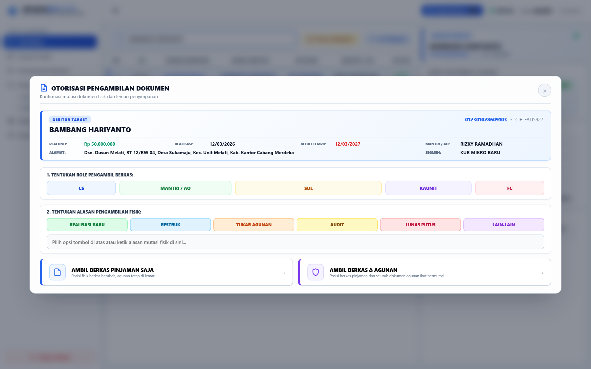
*Gambar 3.2: Modal Otorisasi Pengambilan & Peminjaman Dokumen Fisik dari Ruang Khazanah.*

### 3.3 Prosedur Pengembalian Dokumen Fisik (Kembali ke Lemari)
Jika berkas yang sedang dipinjam telah selesai digunakan, berkas wajib segera dikembalikan ke ruang khazanah:
1. Cari nomor rekening debitur pada modul Cari Berkas.
2. Klik tombol status peminjaman (misal: **`DIPINJAM MANTRI`**).
3. Tinjau modal status peminjaman yang menampilkan durasi peminjaman berjalan dan identitas peminjam.
4. Klik tombol **`KEMBALIKAN KE LEMARI`**. Sistem seketika mengembalikan status spasial menjadi **LEMARI** dan mencatat log waktu pengembalian secara permanen.

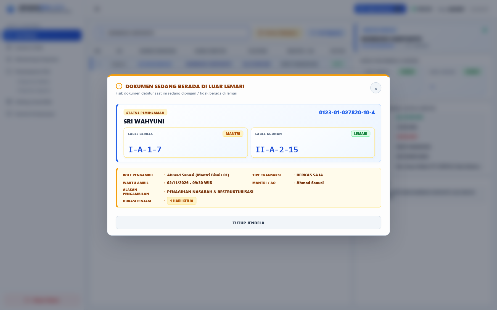
*Gambar 3.3: Modal Status Peminjaman & Konfirmasi Pengembalian Berkas ke Lemari Khazanah.*

### 3.4 Modal Pencarian Dokumen Agunan Fisik Multi-Kriteria
Dalam kondisi nasabah atau pihak berwenang hanya membawa nomor sertifikat tanah atau BPKB tanpa mengetahui nomor rekening pinjaman:
1. Klik tombol **`CARI AGUNAN`** pada pojok kanan atas modul Cari Berkas.
2. Saring berdasarkan jenis jaminan (SHM, SHGB, BPKB, AJB, Petok D, Kuitansi, dll.).
3. Ketik nama pemilik yang tertera pada sertifikat (*Atas Nama*) atau nomor registrasi agunan. Sistem akan langsung mengarahkan ke nomor rekening debitur dan posisi lemari yang menyimpan dokumen tersebut.

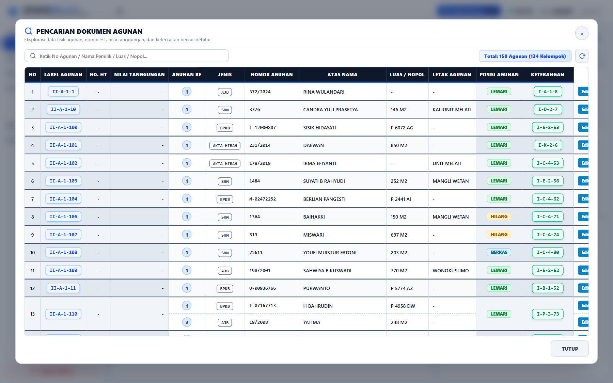
*Gambar 3.4: Modal Pencarian Multi-Kriteria Dokumen Agunan Fisik (Sertifikat Tanah & BPKB Kendaraan).*

---

## BAB IV • SOP PEMINDAIAN DOKUMEN FISIK & REGISTRASI LEMARI KHAZANAH (SCANNER)

Modul **Scanner (`/scanner`)** dirancang untuk alur kerja digitalisasi cepat berkas fisik pinjaman baru dan penataan koordinat penyimpanan di lemari khazanah menggunakan scanner dokumen fisik flatbed / ADF USB.

```
[Ketik Nomor Rekening Pinjaman (15 Digit)]
                  ↓
       [Pengecekan Status Registrasi]
                  ↓
         ⌊ Rekening Sudah Pernah Discan? ⌋
             /                                (BELUM)                     (SUDAH)
            ↓                           ↓
[Buka Modal Live Scanner]      [Buka Modal Registrasi Lemari]
            ↓                           ↓
[Letakkan Lembar Dokumen]      [Pilih Lemari & Boks Khazanah]
            ↓                           ↓
[Mulai Pemindaian Flatbed/ADF] [Tambah/Ubah Rincian Agunan Fisik]
            ↓                           ↓
[Simpan Berkas Digital PDF]    [Simpan & Cetak Label Thermal POS58]
```

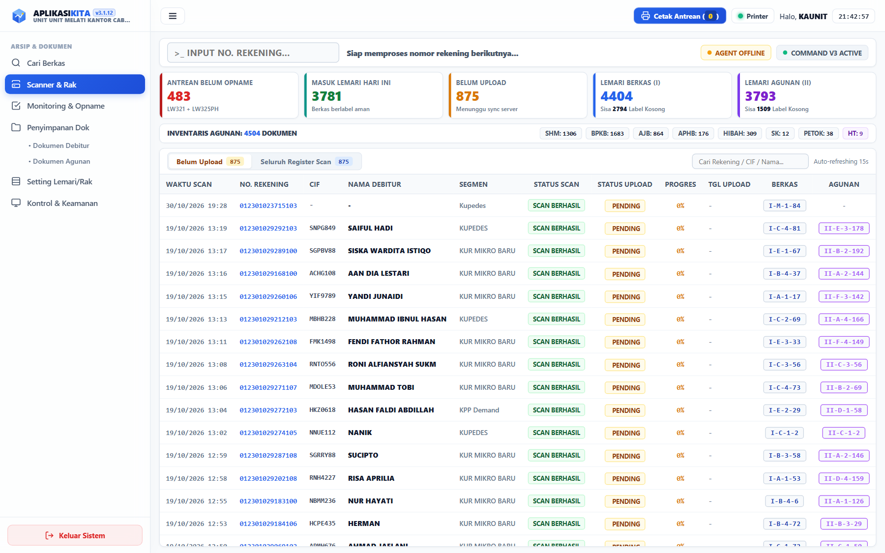
*Gambar 4.1: Antarmuka Utama Modul Pemindaian & Digitalisasi Berkas Jaminan.*

### 4.1 Alur Deteksi Cepat Rekening
1. Posisikan kursor pada kolom input nomor rekening pada modul `/scanner`.
2. Ketikkan 15 digit nomor rekening pinjaman debitur.
3. Sistem secara cerdas memeriksa basis data riwayat registrasi:
   - **Jika Belum Pernah Discan:** Sistem seketika membuka **Modal Scanner Pemindaian Live** untuk memandu pemindaian fisik lembar dokumen kredit.
   - **Jika Sudah Pernah Discan:** Sistem seketika membuka **Modal Registrasi & Penataan Lemari** untuk menata slot khazanah dan memperbarui detail agunan.

### 4.2 Pemindaian Dokumen Baru (*Unscanned Record*)
1. Pada modal live scanner, periksa kesesuaian identitas debitur (Nama, CIF, Plafond, dan Segmen Pinjaman).
2. Masukkan lembar fisik dokumen pinjaman (SPH, SP, KTP/KK, Agunan) ke unit scanner flatbed atau ADF.
3. Klik tombol **`MULAI PINDAI DOKUMEN`**. Sensor pengumpan lembar menghitung jumlah halaman secara akurat dan menyimpannya ke direktori terenkripsi lokal Mini PC dalam format PDF standar perbankan.

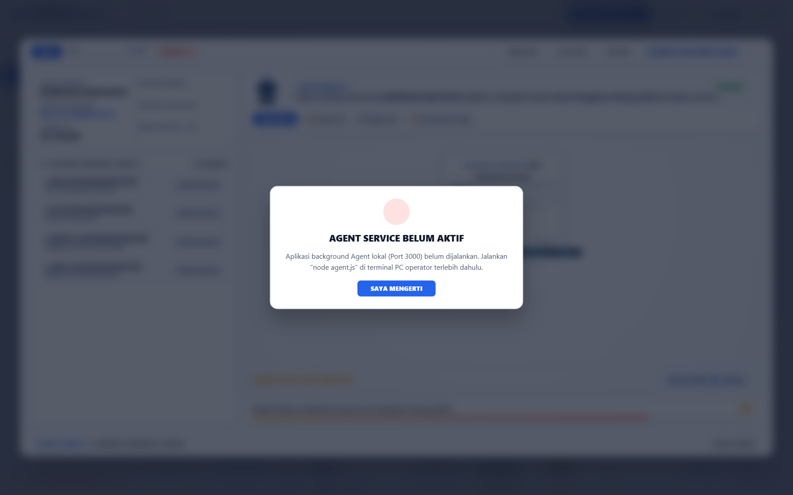
*Gambar 4.2: Modal Scanner Pemindaian Live Dokumen Baru (Integrasi Scanner Fisik Flatbed / ADF).*

### 4.3 Registrasi Koordinat Lemari & Boks Khazanah (*Scanned Record*)
1. Setelah dokumen digital terindeks, tentukan alokasi penyimpanan fisik pada lemari khazanah:
   - **Opsi A (Slot Eksisting):** Mempertahankan koordinat lemari dan boks yang sudah ada sebelumnya.
   - **Opsi B (Rekomendasi Sistem):** Sistem menganalisis utilisasi lemari dan otomatis memilih boks yang masih memiliki kapasitas longgar.
   - **Opsi C (Pilihan Manual):** Membuka sub-modal pemilih koordinat spasial untuk menentukan lemari dan nomor urut boks secara spesifik.
2. Periksa kelengkapan tabel agunan yang terdaftar (SHM, BPKB, dsb.). Tambahkan agunan baru jika diperlukan.
3. Klik tombol **`SIMPAN & CETAK LABEL THERMAL`**. Sistem memperbarui database spasial dan otomatis mencetak stiker label identitas berkas via printer thermal POS58 untuk ditempelkan pada map fisik arsip.

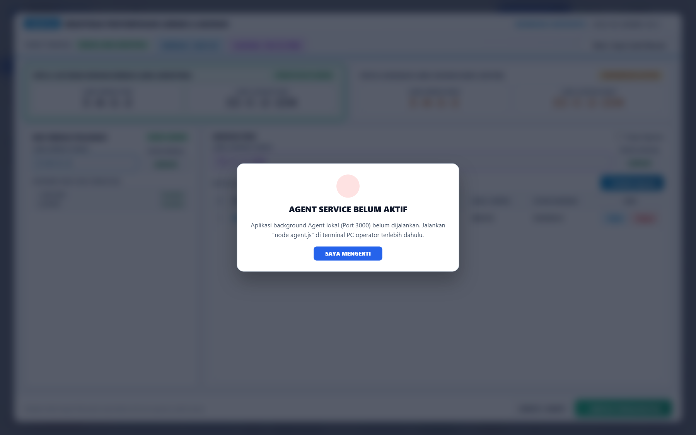
*Gambar 4.3: Modal Registrasi & Penataan Slot Lemari Khazanah Beserta Tabel Agunan Terdaftar.*

### 4.4 Sub-Modal Form Tambah & Ubah Rincian Agunan Fisik
Formulir presisi untuk mencatat spesifikasi teknis dan aspek legalitas jaminan nasabah:
1. Gunakan *Chips Selector* cepat untuk memilih jenis agunan: **SHM**, **SHGB**, **BPKB**, **AJB**, **Petok D**, atau **Kuitansi**.
2. Isi nomor sertifikat/BPKB, nama pemilik terdaftar (Atas Nama), luas tanah / nopol kendaraan, dan letak agunan.
3. Lengkapi nilai tanggungan dan nomor akta Hak Tanggungan (HT) jika diikat secara notariil.

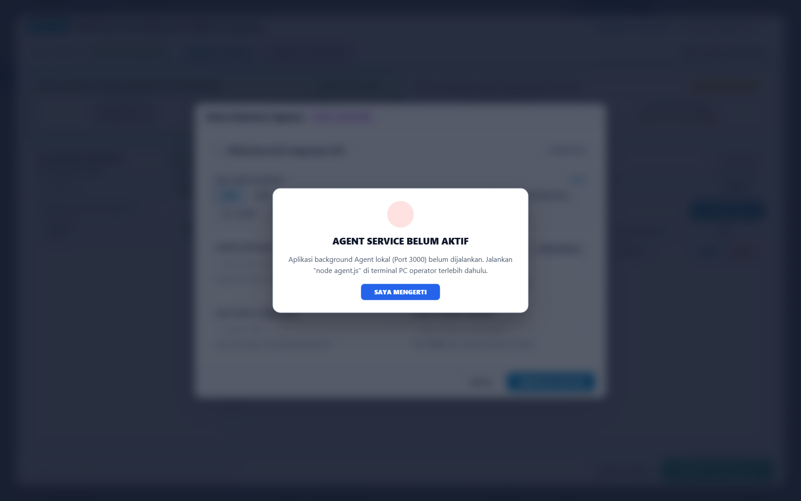
*Gambar 4.4: Sub-Modal Form Tambah & Spesifikasi Teknis Dokumen Agunan Fisik.*

### 4.5 Sub-Modal Pemilihan Manual Slot Lemari Khazanah
Digunakan saat petugas arsip ingin menempatkan map pinjaman pada rak lemari dan boks tertentu secara manual sesuai tata letak fisik ruang khazanah unit.

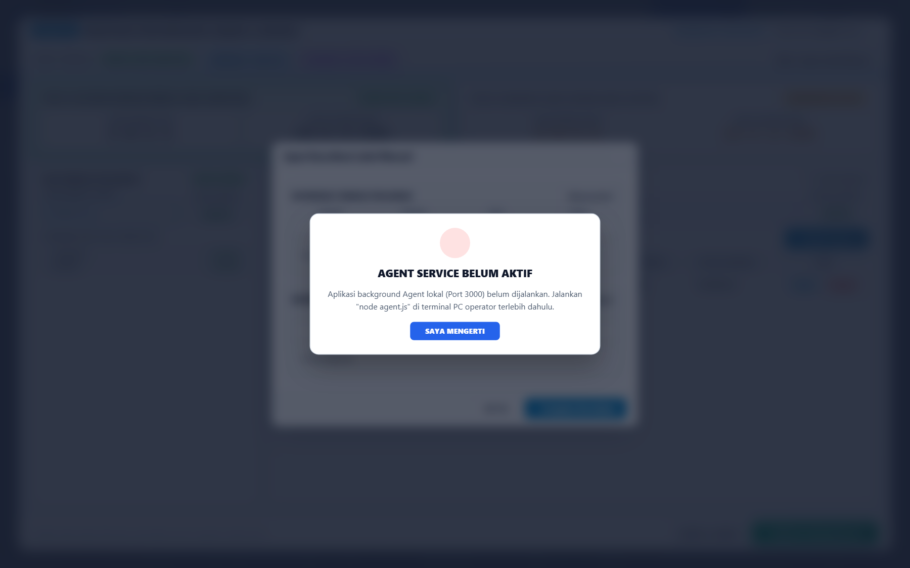
*Gambar 4.5: Sub-Modal Pemilihan Koordinat Manual Slot Lemari & Boks Ruang Khazanah.*

---

## BAB V • SOP TATA KELOLA DOKUMEN LUNAS PUTUS

Modul **Dokumen Lunas Putus (`/dokumen/lunas-putus`)** mengatur integritas dan keamanan pengembalian agunan asli kepada debitur yang kewajiban pinjamannya telah selesai.

### 5.1 Prinsip Verifikasi Lunas Putus vs Real Kembali
Untuk mencegah terjadinya pelepasan jaminan sebelum seluruh kewajiban nasabah lunas, sistem menerapkan algoritma verifikasi CIF ganda:
- **LUNAS PUTUS:** Debitur yang telah menyelesaikan pinjamannya dan **tidak memiliki rekening pinjaman aktif lain** pada CIF yang sama di data nominatif harian terbaru (`data_lw321harian`). Dokumen agunan asli berhak diambil dan diserahkan kepada nasabah secara sah.
- **REAL KEMBALI:** Debitur yang pinjaman lamanya lunas namun CIF-nya terdeteksi memiliki rekening pinjaman aktif baru (suplesi, perpanjangan, atau top-up). Dokumen agunan **TIDAK BOLEH DISERAHKAN** dan statusnya otomatis dikunci sebagai agunan pinjaman berjalan.

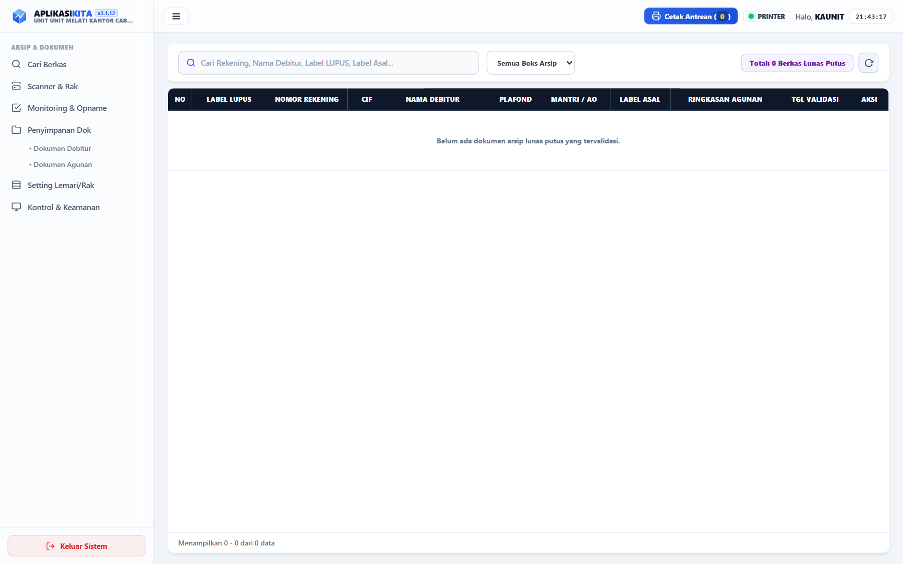
*Gambar 5.1: Modul Tata Kelola Dokumen Debitur Lunas Putus Siap Diserahkan.*

### 5.2 Prosedur Penyerahan Agunan Fisik ke Nasabah
1. Buka menu **Dokumen Lunas Putus**.
2. Periksa badge status pelunasan: pastikan berstatus hijau **`LUNAS PUTUS`**.
3. Petugas Brimen mencocokkan dokumen fisik yang diambil dari lemari dengan rincian agunan pada sistem.
4. Klik tombol **`SERAHKAN AGUNAN`**. Sistem mencetak Berita Acara Serah Terima (BAST) Agunan dan memperbarui riwayat pelepasan jaminan.

---

## BAB VI • SOP MONITORING PORTOFOLIO KREDIT & PENAGIHAN HARIAN

### 6.1 Monitoring Portofolio & Kuadran Risiko (`/dashboard`)
1. Buka halaman **Dashboard Monitoring Portofolio**.
2. Tinjau **8 Kartu KPI Utama**: Total Outstanding (OS), DPK Simpanan, NPL Portofolio, Kol 2 Menunggak, PTP Hari Ini & Proyeksi Esok, Runoff Jatuh Tempo, Realisasi Kredit Baru, dan Retensi Nasabah.
3. Gunakan filter Mantri, Segmen Produk (Kupedes/KUR), dan Kolektibilitas untuk analisis portofolio spesifik.


*Gambar 6.1: Dashboard Eksekutif Monitoring Portofolio Kredit & Kuadran Risiko Unit Kerja.*

### 6.2 Modal Detail Debitur & Kalkulasi Filter Interaktif
Setiap klik pada baris data, tabel pergeseran kolektibilitas, atau kartu KPI membuka **Modal Detail Debitur** eksekutif yang secara dinamis menghitung ulang total baki debet dan rekapitulasi data sesuai filter aktif.

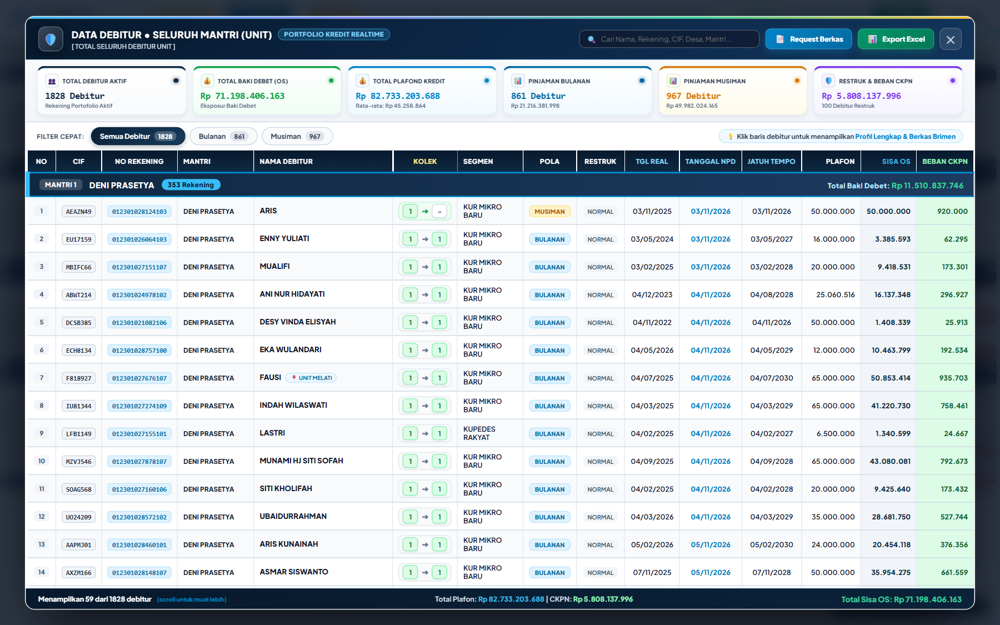
*Gambar 6.2: Modal Detail Debitur Eksekutif dengan Kalkulasi Dinamis & Rekapitulasi Kolektibilitas.*

### 6.3 Eksekusi Tagihan Harian Mantri & Proyeksi Tagihan Esok Hari (`/tagihan`)
1. Setiap Mantri membuka modul **Tagihan Harian** setiap pagi.
2. Sistem menyajikan daftar debitur jatuh tempo hari ini (H-0) beserta tab khusus **Proyeksi Esok Hari (H+1)** untuk persiapan penagihan preventif.
3. Terapkan filter cepat skema pembayaran: *Bulanan*, *Musiman*, *Kupedes*, *KUR*, atau *Belum Bayar*.
4. Catat janji bayar (PTP), hasil kunjungan lapangan, dan pembaruan komitmen bayar debitur secara *real-time*.

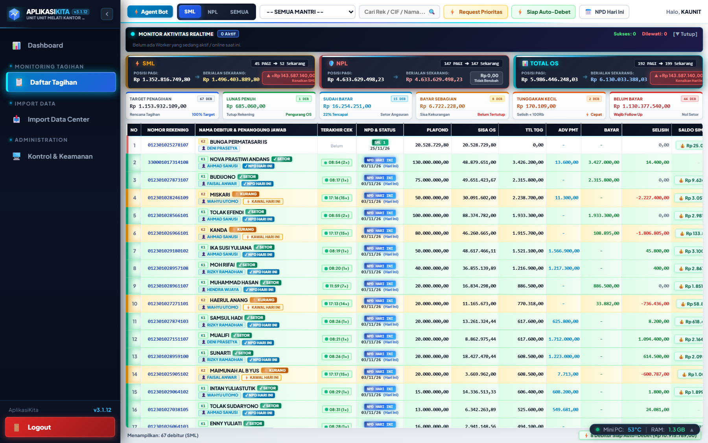
*Gambar 6.3: Dashboard Tagihan Harian Mantri & Proyeksi Tagihan PTP Esok Hari (H+1).*

---

## BAB VII • SOP AUDIT SPASIAL LEMARI & STOCK OPNAME KHAZANAH

Modul **Monitoring Lemari (`/monitoring-lemari`)** berfungsi sebagai sarana visualisasi spasial ruang khazanah unit kerja dan instrumen audit kepatuhan arsip berkas pinjaman.

### 7.1 Pemantauan Tingkat Keterisian (*Fill Rate*)
- Buka menu **Monitoring Lemari**.
- Tinjau peta grid visual lemari khazanah unit:
  - **Indikator Hijau:** Boks memiliki kapasitas longgar (siap ditempati berkas baru).
  - **Indikator Kuning:** Boks terisi lebih dari 70% kapasitas maksimal.
  - **Indikator Merah:** Boks penuh (tidak disarankan menambah berkas tanpa reorganisasi ruang).


*Gambar 7.1: Peta Matriks Visual Keterisian Lemari Khazanah & Monitoring Stock Opname Spasial.*

### 7.2 Pelaksanaan Stock Opname Fisik Khazanah
1. Pilih lemari dan boks target opname pada matriks visual.
2. Sistem menampilkan daftar rekening yang seharusnya berada di dalam boks tersebut.
3. Petugas Brimen mencocokkan fisik berkas pada rak khazanah satu per satu. Jika berkas fisik sesuai, tandai centang verifikasi opname. Jika ada selisih, sistem mencatat status selisih audit secara otomatis.

---

## BAB VIII • SOP KONTROL SERVER MINI PC, PENCADANGAN CLOUD & KEAMANAN LAN

Modul **Pengaturan Server (`/pengaturan/server`)** didedikasikan bagi Administrator dan Kepala Unit untuk menjaga reliabilitas hardware Mini PC, kepatuhan backup otomatis, dan keamanan jaringan lokal kantor unit.

### 8.1 Telemetri Kesehatan Hardware Mini PC
- **Suhu CPU:** Suhu operasional normal berada di kisaran 40°C – 65°C. Jika suhu melebihi 75°C, pastikan ventilasi Mini PC bersih dan sirkulasi udara ruang kerja lancar.
- **Kapasitas Penyimpanan Disk:** Batas toleransi aman penggunaan SSD/eMMC adalah di bawah 85%. Jika partisi hampir penuh, bersihkan log lama melalui tombol pembersih cache.
- **Layanan Sistem Inti:** Pastikan status Nginx, PHP-FPM 8.4, MariaDB 10.11, CUPS Daemon (Printer), dan WA Gateway berstatus hijau (**RUNNING**).

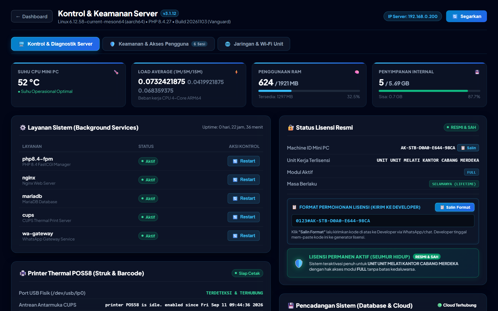
*Gambar 8.1: Pusat Kontrol Telemetri & Pemeliharaan Hardware Server Mini PC.*

### 8.2 Otomatisasi Pencadangan Cloud Google Drive
Sistem mengeksekusi pencadangan database relasional dan arsip digital secara berkala via engine Rclone terisolasi:
1. Setiap hari pukul 17:30 WIB, dump database terenkripsi dibuat secara otomatis.
2. File backup diunggah langsung ke penyimpanan Google Drive unit kerja.
3. Status pencadangan dapat dipantau langsung pada tab Cloud Backup modul Pengaturan Server.

### 8.3 Keamanan Perimeter Jaringan LAN & Whitelist Wi-Fi
Untuk mencegah akses tidak sah dari luar kantor unit kerja:
1. Buka tab **Keamanan Jaringan & Firewall** pada modul Pengaturan Server.
2. Tinjau daftar IP perangkat yang terhubung ke jaringan unit.
3. Perangkat baru wajib didaftarkan pada tabel Whitelist IP / MAC Address agar mendapatkan izin akses ke server AplikasiKita.


*Gambar 8.2: Manajemen Keamanan Perimeter Jaringan LAN, Firewall, & Whitelist Perangkat Wi-Fi.*

---

## BAB IX • PANDUAN PENANGANAN KENDALA (TROUBLESHOOTING FAQ)

| Gejala Kendala | Kemungkinan Penyebab | Langkah Penanganan Terstandarisasi |
| :--- | :--- | :--- |
| **Printer Thermal POS58 tidak merespons cetak.** | Kabel USB printer longgar atau port `/dev/usb/lp0` belum terdeteksi sistem Mini PC. | 1. Periksa sambungan kabel USB fisik printer ke Mini PC.<br>2. Masuk ke `/pengaturan/server?tab=server`, periksa status **CUPS Daemon**.<br>3. Klik tombol **`Restart CUPS`** untuk menyegarkan antrean cetak raw USB. |
| **Halaman web terasa lambat diakses dari laptop petugas.** | Beban RAM server tinggi atau koneksi switch LAN kantor unit bermasalah. | 1. Periksa pemakaian RAM dan CPU pada dashboard kontrol server.<br>2. Klik tombol **`Bersihkan Cache Aplikasi`** (`artisan optimize:clear`).<br>3. Pastikan kabel LAN laptop tersambung langsung ke switch kantor unit. |
| **Sertifikat / BPKB nasabah lunas tidak muncul di Lunas Putus.** | Data pelunasan belum diimpor atau nomor rekening masih terdaftar aktif di nominatif. | 1. Pastikan file nominatif terbaru telah diimpor melalui modul `/import`.<br>2. Periksa apakah CIF nasabah memiliki rekening pinjaman aktif lain (berstatus Real Kembali). |
| **Scanner dokumen flatbed/ADF tidak mendeteksi lembar kertas.** | Driver scanner USB belum tersambung atau feeder kertas macet (*paper jam*). | 1. Periksa kabel USB scanner dokumen.<br>2. Buka penutup scanner dan pastikan tidak ada kertas tersangkut.<br>3. Refresh halaman `/scanner` untuk inisialisasi ulang perangkat. |

---

*Dokumen Panduan Standar Operasional Prosedur (SOP) • Sistem AplikasiKita v3.1.12 Vanguard • © 2026 Tim Pengembang Operasional. Hak Cipta Dilindungi Undang-Undang.*
