# 🚀 APLIKASIKITA (Platform Operasional Mini PC)

**Platform Digital Tata Kelola Operasional, Monitoring Portofolio Pinjaman & Tata Arsip Digital**  
*Versi:* `AplikasiKita-v3.3.0` | *Codename:* `Vanguard` | *Build:* `#20261111` | *Target Arsitektur:* Multi-Unit Mini PC Linux (Armbian/Debian/Ubuntu ARM64 & x86_64)

---

## 📖 1. Gambaran Umum Sistem

**AplikasiKita** adalah platform operasional internal perbankan berbasis web yang dibangun dengan kerangka kerja modern **Laravel 13** dan runtime **PHP 8.4**. Sistem ini dirancang secara khusus untuk beroperasi mandiri (*offline-first*) di atas perangkat **Mini PC** Linux pada setiap kantor unit kerja operasional.

Aplikasi ini menjamin kelancaran operasional harian kantor unit tanpa ketergantungan koneksi internet publik yang konstan, menyediakan pemantauan komprehensif portofolio debitur secara *real-time*, integrasi tata arsip berkas jaminan digital, pencetakan tanda terima dan label tanda pengenal berkas via printer thermal POS58 USB, layanan otomatisasi laporan terjadwal WhatsApp 4 sesi operasional harian, serta pusat kontrol hardware server dan mitigasi keamanan jaringan LAN tingkat tinggi.

Repositori ini berfungsi sebagai **Kanal Distribusi** terpusat untuk mendistribusikan pembaruan sistem secara berkesinambungan (*Pembaruan Otomatis Git*) ke seluruh jaringan perangkat Mini PC yang tersebar di kantor-kantor unit.

---

## ⚙️ 2. Arsitektur & Kebutuhan Server

Untuk menjamin kinerja tinggi, stabilitas 24/7, dan latensi rendah pada lingkungan kantor unit, spesifikasi minimum server Mini PC adalah sebagai berikut:

### A. Spesifikasi Perangkat Keras Minimum
* **Prosesor (CPU)**: Minimum 4-Core ARM64 (Cortex-A53 / Cortex-A55 @ 1.5 GHz+) atau prosesor x86_64 Dual-Core 2.0 GHz+.
* **Memori RAM**: Minimum **2 GB** (Rekomendasi: 2 GB – 4 GB LPDDR3/LPDDR4).
* **Penyimpanan Internal**: Minimum **8 GB** eMMC 5.1 / SSD SATA (Rekomendasi: 16 GB+ dengan ketahanan write tinggi).
* **Konektivitas USB**: 1x Port USB 2.0 untuk integrasi Printer Thermal POS58 direct-attached (`/dev/usb/lp0`).
* **Konektivitas Jaringan**: 1x Port RJ45 Ethernet LAN 100/1000 Mbps terhubung ke switch lokal unit kerja.

### B. Perangkat Lunak & Lingkungan Eksekusi

| Komponen / Modul | Versi Minimum | Versi Rekomendasi | Fungsi & Peran Operasional |
| :--- | :---: | :---: | :--- |
| **Sistem Operasi** | Linux Kernel 5.10+ | Armbian 24.x / Ubuntu 24.04 LTS / Debian 12 | Sistem operasi dasar Mini PC (Arsitektur aarch64 / x86_64) |
| **Web Server** | Nginx 1.18.0 | Nginx 1.24.x+ | Akselerasi HTTP/2, reverse proxy FPM, enkripsi TLS 1.3 lokal |
| **PHP Runtime** | PHP 8.2.0 | **PHP 8.4.x (PHP-FPM)** | Eksekutor backend Laravel 13 berkinerja tinggi |
| **Ekstensi PHP Wajib** | - | `php-fpm`, `php-mysql`, `php-mbstring`, `php-xml`, `php-curl`, `php-zip`, `php-bcmath`, `php-intl`, `php-gd` | Pengolah kalkulasi baki debet, kompresi berkas, dan modul grafis |
| **Database Server** | MariaDB 10.6 | **MariaDB 10.11+ / MySQL 8.0** | Database relasional transaksional ACID (Engine InnoDB, utf8mb4) |
| **In-Memory Cache & Session** | Redis 6.x | **Redis 7.0+ (php-redis)** | High-throughput session driver, lock manager, real-time queues |
| **Search Engine (FTS)** | Meilisearch v1.x | **Meilisearch ARM64 v1.56+** | Fast typo-tolerant indexing debitur & agunan (< 5 ms latency) |
| **Headless Runtime** | Node.js v18.0 LTS | **Node.js v20.x LTS** | Runtime otomatisasi tangkapan layar laporan (Pemroses Halaman Web Mandiri) |
| **Layanan Percetakan** | CUPS 2.4.x | CUPS Daemon | Driver antrean cetak thermal USB (`/dev/usb/lp0`) raw protocol |
| **Pencadangan Data** | Rclone v1.60.0 | Rclone v1.66+ | Pencadangan cloud Google Drive modular terisolasi per unit kerja |
| **Manajemen Layanan** | systemd 245+ | systemd 255+ | Watchdog otomatis, restart service gagal, dan penjadwalan cron |

---

## 📸 3. Ikhtisar Antarmuka & Panduan Operasional Fitur (v3.2.3 Vanguard)

> [!NOTE]
> **Privasi & Sanitasi Data**: Seluruh tangkapan layar antarmuka di bawah ini telah disanitasi secara ketat dan menggunakan data simulasi/dummy untuk keperluan dokumentasi sistem. Tidak ada data nasabah riil, nomor rekening nyata, maupun kode unit kerja yang ditampilkan.

---

### 1. Portal Login & Manajemen Multi-Peran (`/login`)

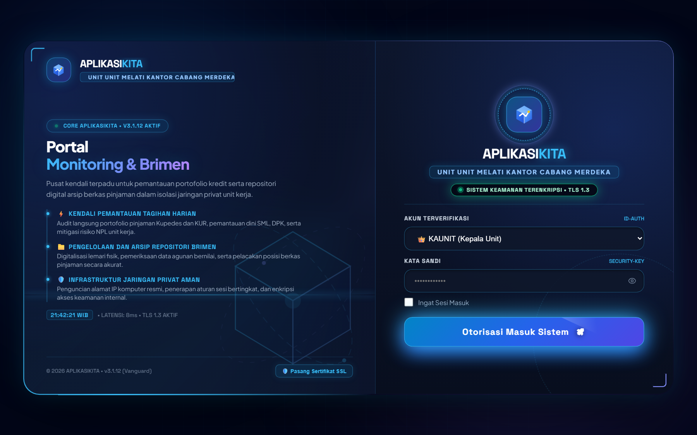

- **Tujuan Operasional**: Pintu gerbang keamanan akses sistem terotentikasi (*Role-Based Access Control*) bagi seluruh insan unit kerja.
- **Fitur Utama**:
  - Antarmuka bertema *midnight blue glassmorphism* dengan identitas unit operasional dinamis.
  - Pemilih Akun Peran Interaktif: Kepala Unit (Kaunit), Mantri Mikro / Bisnis, Petugas Arsip Digital (Brimen), Customer Service (CS), Supervisor Layanan Operasional (SOL), dan Administrator Sistem.
  - Modul Panduan & Unduh Sertifikat Keamanan SSL untuk browser internal LAN.
  - Proteksi Brute-force & Pembatasan IP Subnet jaringan LAN kantor unit.

---

### 2. Dashboard Monitoring Portofolio Kredit & Matriks Kuadran (`/dashboard`)

- **Tujuan Operasional**: Pusat kendali eksekutif untuk memantau pergerakan baki debet, debitur menunggak, dan matriks risiko portofolio secara *real-time*.
- **Fitur Utama**:
  - **8 Indikator KPI Utama**: Total Outstanding (OS), DPK Simpanan, Rasio NPL, Rasio LAR, Realisasi Bulanan, Restrukturisasi, Run-Off Harian, dan Efisiensi Operasional.
  - **Matriks Kuadran Transisi Portofolio 4-Grid**: Memetakan debitur berdasarkan kualitas pembayaran, potensi pemulihan, dan risiko pemburukan.
  - **Tabel Monitoring Kredit Dinamis**: Baseline, Realtime, dan Delta baki debet per Mantri yang tersinkronisasi proporsional di seluruh resolusi layar (1366×768 s/d 1920×1080).

---

### 2b. Modal Universal Detail Debitur, KPI Deck & Filter Cepat

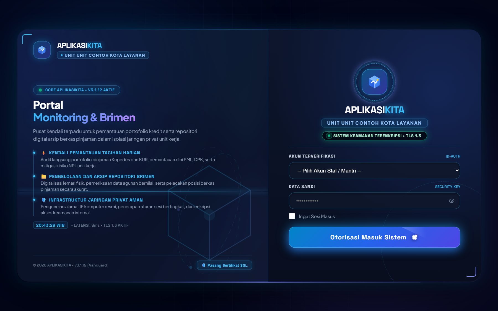

- **Tujuan Operasional**: Sarana investigasi mendalam (*drilldown*) seluruh rekening debitur dari kartu KPI, matriks kolektibilitas, kuadran, maupun baris total unit.
- **Fitur Utama**:
  - **Kartu Ringkasan KPI Modal**: Kalkulasi otomatis baki debet, rata-rata DPD, tunggakan pokok, dan bunga yang otomatis menghitung ulang sesuai filter aktif.
  - **Bilah Filter Cepat (*Quick Filter Chips*)**: Penyaringan instan berdasarkan segmen (KUR/Kupedes), pola angsuran (Bulanan/Musiman), status pembayaran, pergeseran kolektibilitas, dan status pelunasan CIF murni (*Real Kembali vs Lunas Putus*).
  - **Tab Navigasi Waktu Penagihan**: Pilihan proyeksi penagihan *Hari Ini (H-0)* dan *Proyeksi Esok Hari (H+1)* untuk pemantauan Run-Off & PTP.
  - **Integrasi Cetak & Ekspor**: Ekspor Excel berformat standar perbankan dan akses satu klik ke Profil Lengkap Debitur.

---

### 3. Pencarian Berkas & Manajemen Lokasi Fisik Agunan (`/cariberkas`)

- **Tujuan Operasional**: Mesin pencari instan arsip dokumen kredit dan jaminan fisik dengan pemetaan spasial ruang arsip berkas unit.
- **Fitur Utama**:
  - Pencarian multi-kriteria: Nomor Rekening (minimal 5 digit), Nama Debitur (minimal 3 huruf), Nomor CIF, atau Nomor Agunan (SHM/BPKB).
  - Panel Inspektur Berkas 360°: Menampilkan identitas debitur terpilih, status kelengkapan dokumen, plafond, tanggal realisasi, jatuh tempo, Mantri pengelola, dan rincian agunan.
  - Indikator Status Fisik: Penandaan jelas posisi dokumen saat ini (`LEMARI`, `DIPINJAM`, `CS`, `MANTRI`, atau `LUNAS PUTUS`).

---

### 3b. Modal Otorisasi Pengambilan & Peminjaman Dokumen Fisik

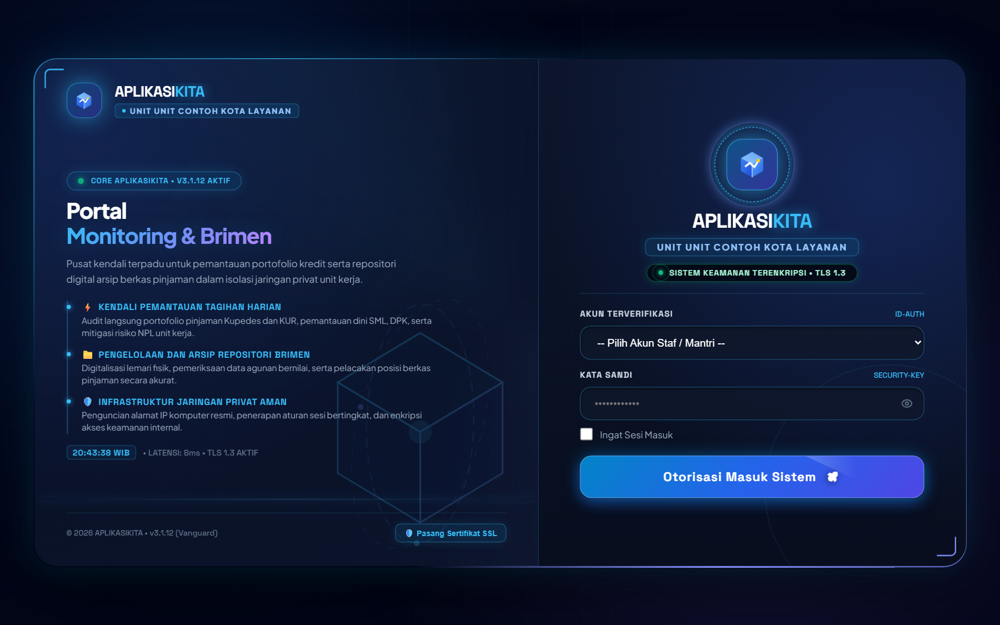

- **Tujuan Operasional**: Kontrol mutasi dokumen fisik keluar dari lemari penyimpanan ruang arsip unit kerja.
- **Fitur Utama**:
  - Pemilihan Peminjam Dokumen: Pilihan peran petugas (Mantri Pengelola, CS, SOL, Kaunit, atau Auditor).
  - Pencatatan Alasan Peminjaman: Penagihan nasabah, klaim asuransi, restrukturisasi kredit, pengecekan agunan, atau keperluan audit.
  - Tombol Otorisasi Selektif: `AMBIL BERKAS SAJA`, `AMBIL AGUNAN SAJA`, atau `AMBIL KEDUANYA`.
  - Otomatisasi Pencetakan Lembar Bukti Peminjaman (Struk Thermal POS58 USB) sebagai tanda terima sah.

---

### 3c. Modal Status Peminjaman & Pengembalian Dokumen ke Lemari

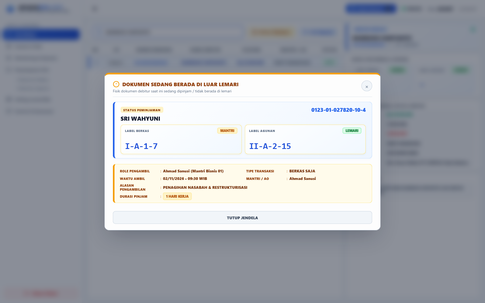

- **Tujuan Operasional**: Pemantauan dokumen yang sedang berada di luar lemari dan eksekusi pengembalian fisik ke slot lemari asal.
- **Fitur Utama**:
  - Tampilan rincian nama peminjam, tanggal/jam pengambilan, serta durasi peminjaman (*Service Level Agreement / SLA counter*).
  - Tombol Tindakan Tunggal: **`KEMBALIKAN KE LEMARI`** untuk mengembalikan dokumen ke posisi aman.
  - Riwayat mutasi tercatat otomatis pada buku register digital unit kerja.

---

### 3d. Modal Pencarian Dokumen Agunan Fisik Multi-Kriteria

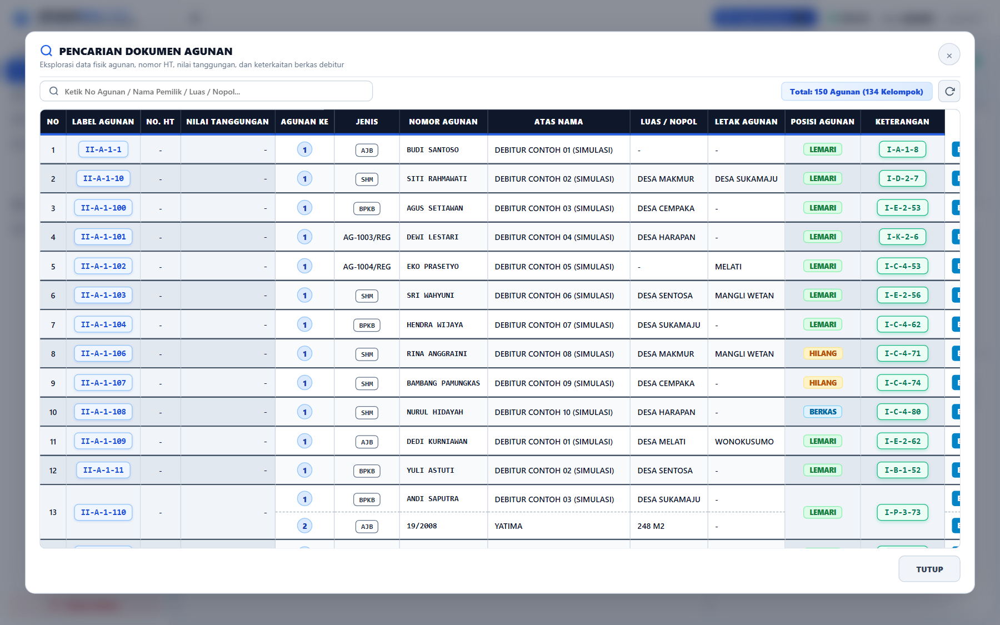

- **Tujuan Operasional**: Pencarian dokumen jaminan secara spesifik tanpa harus mengetahui nomor rekening pinjaman debitur.
- **Fitur Utama**:
  - Filter jenis agunan: SHM, SHGB, BPKB, AJB, Petok D, Kuitansi, dan agunan lainnya.
  - Pencarian berdasarkan nama pemilik agunan pada sertifikat (*Atas Nama*) atau nomor registrasi agunan.
  - Menampilkan lokasi penyimpanan agunan di lemari serta status opname berkas.

---

### 4. Modul Pemindaian & Digitalisasi Berkas Jaminan (`/scanner`)

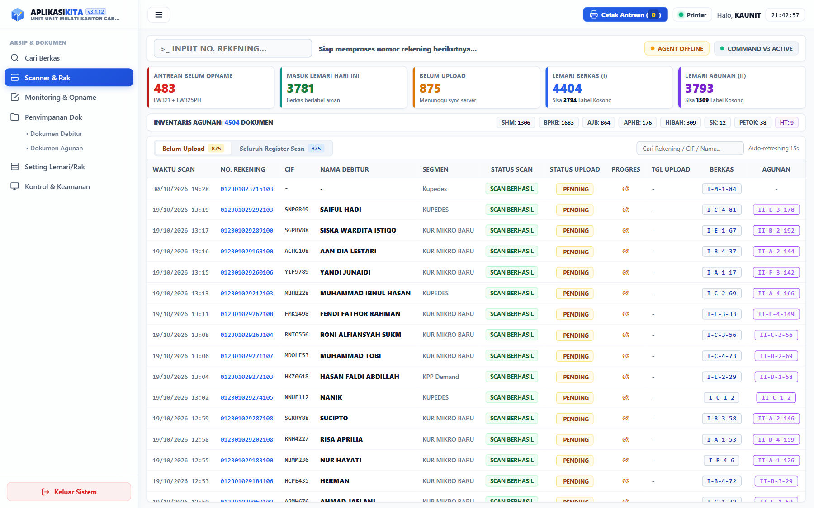

- **Tujuan Operasional**: Antarmuka berkecepatan tinggi untuk digitalisasi berkas kredit fisik jaminan dan penataan arsip lemari arsip berkas.
- **Fitur Utama**:
  - Mode Input Otomatis: Deteksi instan pengetikan nomor rekening pinjaman 15-digit untuk memicu scanner fisik atau registrasi lemari.
  - Umpan Balik Suara & Audio Robotik (*Robo-Voice Feedback*): Mengonfirmasi nama debitur dan status berkas secara verbal.
  - Tabel Riwayat Pindai Terkini: Menampilkan daftar berkas yang baru saja diproses beserta status lembar dokumen.

---

### 4b. Modal Scanner Pemindaian Live Dokumen Baru (*Unscanned Record*)

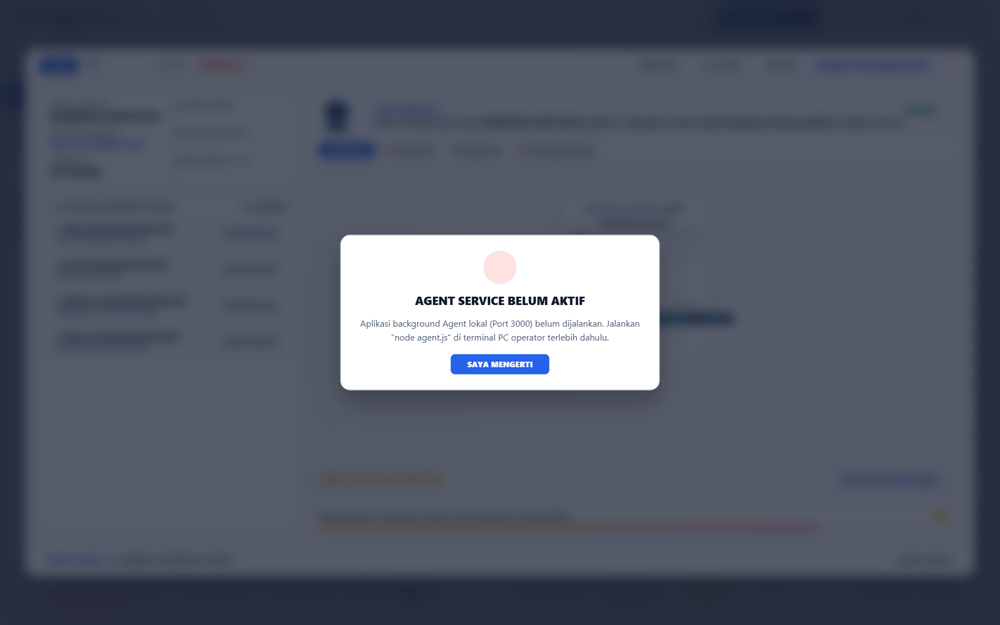

- **Tujuan Operasional**: Panduan interaktif saat operator melakukan pemindaian fisik lembar dokumen pinjaman (SPH, SP, KTP, Agunan, dll.).
- **Fitur Utama**:
  - Kartu Profil Debitur: Nomor rekening, CIF, nama debitur, plafond, dan segmen pinjaman.
  - Jalur Penyimpanan Otomatis: Pembuatan direktori terstruktur lokal unit kerja secara otomatis.
  - Sensor Pengumpan Lembar (*Sheet Counter & Timer*): Penghitung jumlah lembar terdeteksi dan batas waktu pemindaian.
  - Manifest Dokumen: Ceklis otomatis kelengkapan berkas yang dipindai.

---

### 4c. Modal Registrasi & Penataan Slot Lemari Arsip berkas (*Scanned Record*)

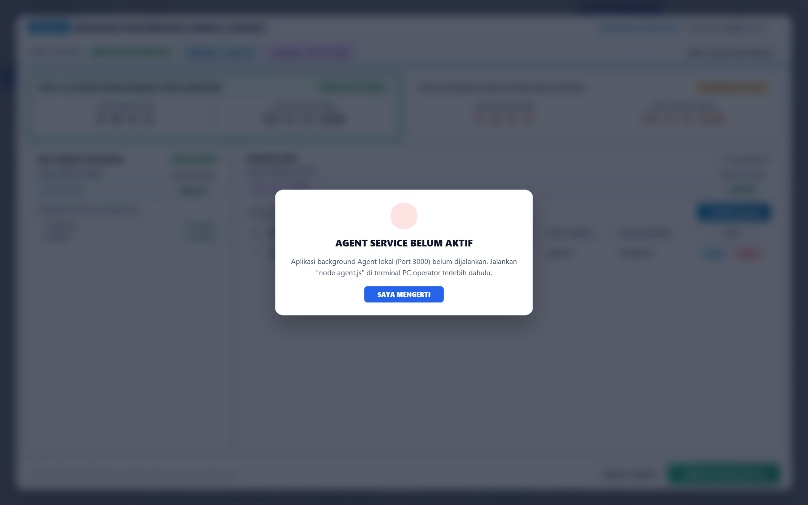

- **Tujuan Operasional**: Penentuan koordinat lokasi penyimpanan fisik berkas dan agunan di lemari arsip berkas pasca-pemindaian.
- **Fitur Utama**:
  - **Opsi A (Slot Eksisting)**: Mempertahankan koordinat lemari lama jika berkas sudah memiliki slot sebelumnya.
  - **Opsi B (Rekomendasi Sistem)**: Rekomendasi otomatis slot lemari dan boks kosong terdekat yang optimal.
  - **Opsi C (Pilihan Manual)**: Pemilihan manual lokasi lemari dan nomor urut boks sesuai kebutuhan fisik ruang arsip.
  - Mini Manifest Scanned: Ringkasan dokumen digital PDF yang terdaftar.
  - Tabel Agunan Terdaftar: Detail jenis agunan, nomor jaminan, atas nama, nilai tanggungan, dan status Hak Tanggungan (HT).
  - Tombol **`SIMPAN & CETAK LABEL THERMAL`** untuk mencetak stiker label berkas secara instan.

---

### 4d. Sub-Modal Form Tambah & Ubah Rincian Agunan Fisik

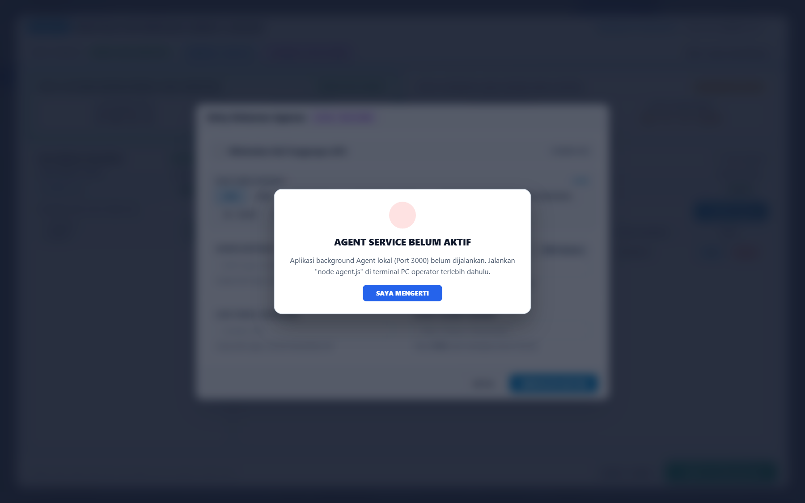

- **Tujuan Operasional**: Formulir presisi untuk mencatat spesifikasi teknis dan hukum dokumen jaminan debitur.
- **Fitur Utama**:
  - *Chips Selector* Jenis Agunan Cepat: SHM, SHGB, BPKB, AJB, PETOK D, KUITANSI, dll.
  - Bidang Isian: Nomor Sertifikat/BPKB, Atas Nama Pemilik, Luas Tanah / Nomor Polisi, Letak/Alamat Agunan.
  - Kolom Pendaftaran Hak Tanggungan (HT): Nomor Akta HT dan Nilai Hak Tanggungan.

---

### 4e. Sub-Modal Pemilihan Manual Slot Lemari & Boks ruang arsip

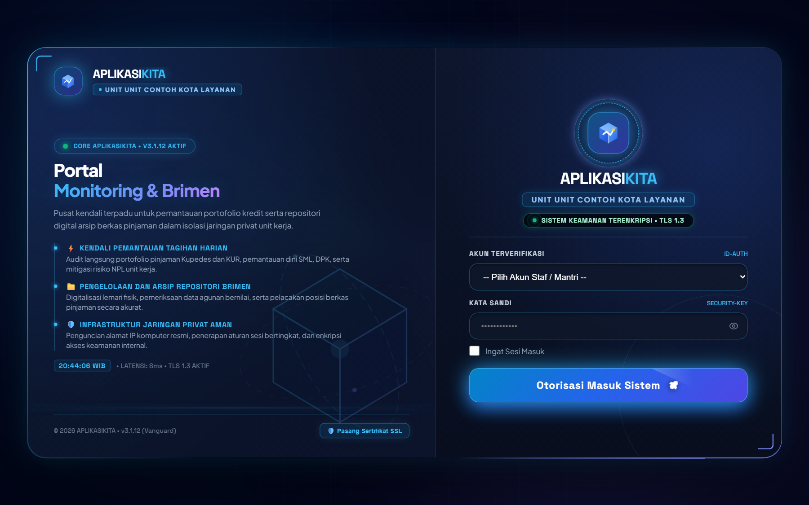

- **Tujuan Operasional**: Penempatan spasial presisi saat operator ingin menata berkas pada rak atau boks tertentu di ruang arsip berkas.
- **Fitur Utama**:
  - Pemilihan Ruangan ruang arsip, Nomor Lemari, Nomor Rak, dan Nomor Urut Dokumen.
  - Deteksi otomatis kapasitas boks terisi agar tidak melebihi batas muat fisik.

---

### 5. Manajemen Berkas Pinjaman Lunas Putus (`/dokumen/lunas-putus`)

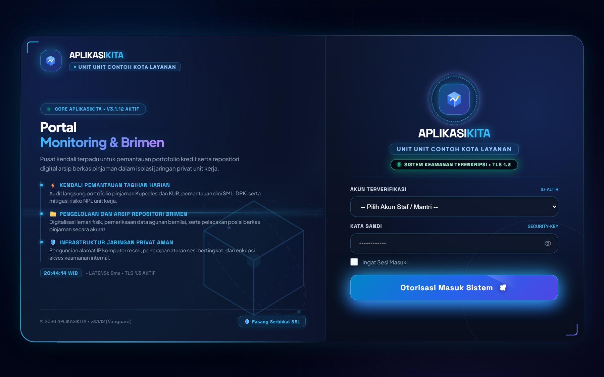

- **Tujuan Operasional**: Tata kelola khusus pengarsipan dan pengembalian dokumen jaminan untuk pinjaman yang telah berstatus lunas penuh (*Lunas Putus*).
- **Fitur Utama**:
  - Daftar antrean berkas lunas yang siap diserahkan kepada nasabah.
  - Verifikasi serah terima agunan lengkap dengan pencatatan identitas penerima dan tanda terima fisik.
  - Pemindahan otomatis status arsip dari lemari aktif ke rak arsip lunas putus.
  - Riwayat audit pencatatan tanggal pelunasan dan petugas penyerah dokumen.

---

### 6. Monitoring Denah Spasial Lemari & Kapasitas Boks ruang arsip (`/monitoring-lemari`)

- **Tujuan Operasional**: Representasi visual denah lemari dan tingkat keterisian ruang arsip berkas kantor unit kerja.
- **Fitur Utama**:
  - Visualisasi Grid Spasial: Menampilkan seluruh lemari, rak, dan boks penyimpanan secara proporsional.
  - Indikator Kapasitas (*Fill Rate*): Kode warna status keterisian boks (Hijau: Tersedia, Kuning: Hampir Penuh, Merah: Penuh).
  - Manajemen Tambah/Hapus Boks dan Penataan Ulang Nomor Urut Penyimpanan.
  - Alat Audit Cepat ruang arsip: Mempermudah pelaksanaan stock opname fisik berkas secara berkala.

---

### 7. Tagihan Harian Mantri & Monitoring Penurunan Baki Debet (`/tagihan`)

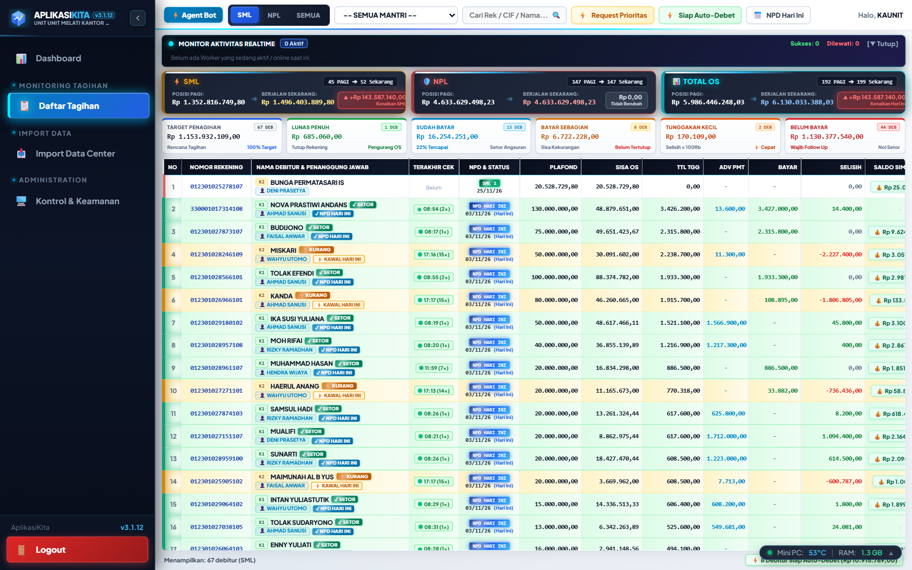

- **Tujuan Operasional**: Instrumen harian pengelola kredit (Mantri) untuk mengeksekusi penagihan debitur menunggak dan memantau realisasi penurunan baki debet hari ini.
- **Fitur Utama**:
  - Tabel Daftar Tagihan Dinamis: Nomor rekening rapi (15 digit terstandarisasi), nama nasabah, baki debet, tunggakan pokok, dan bunga.
  - Kalkulasi Penurunan OS Akurat: Pelunasan debitur tercatat murni sebagai penurunan baki debet tanpa anomali.
  - Tombol Cetak Struk Tagihan Kasir Thermal POS58 USB.
  - Filter interaktif per Mantri dan per Wilayah Desa/Kelurahan binaan.

---

### 8. Pusat Kontrol Hardware & Layanan Server Mini PC (`/pengaturan/server?tab=server`)

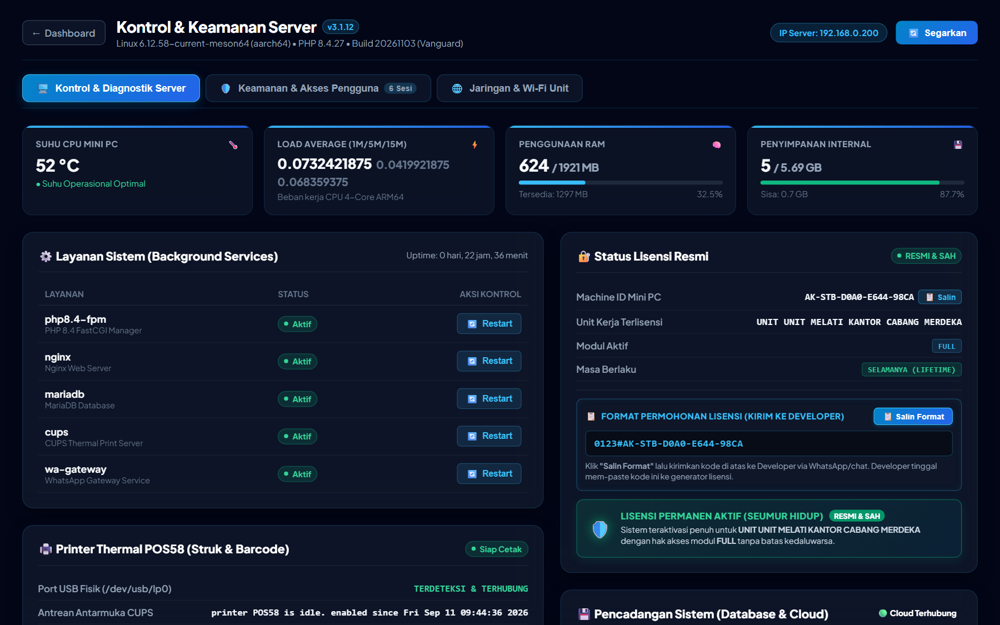

- **Tujuan Operasional**: Pemantauan kesehatan fisik perangkat keras Mini PC dan pengelolaan layanan sistem terpusat.
- **Fitur Utama**:
  - **Telemetri Hardware Real-Time**: Persentase penggunaan CPU, konsumsi RAM, suhu processor (°C), dan kapasitas sisa penyimpanan internal.
  - **Panel Kontrol Layanan Sistem**: Status real-time Nginx Web Server, PHP-FPM, Database MariaDB, WhatsApp Gateway, dan CUPS Printing Daemon.
  - **Manajemen Daya & Pemeliharaan**: Tombol Reboot Server Aman dan Shutdown Terjadwal.
  - **Pencadangan Cloud Google Drive**: Modul cadangan otomatis terenkripsi per unit kerja dengan pemantauan kuota penyimpanan cloud.
  - **Informasi Versi & Pembaruan**: Nomor versi terpasang (`v3.3.0 Vanguard`), hash komit Git, dan status sinkronisasi.

---

### 10. Pusat Impor Data & Validasi Berkas Harian (`/import`)

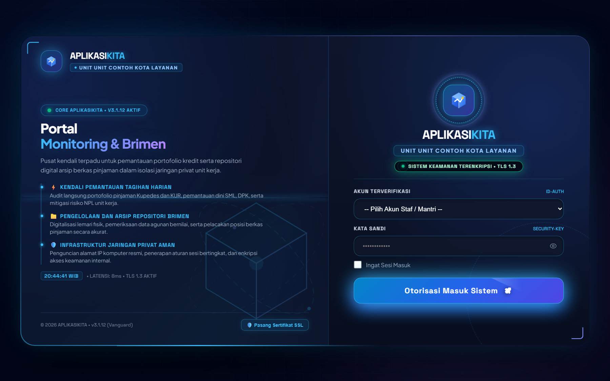

- **Tujuan Operasional**: Fasilitas integrasi berkas nominatif harian (`data_lw321harian`, `data_lw321bulanan`, `data_lw325ph`) ke dalam basis data sistem.
- **Fitur Utama**:
  - Area Unggah Berkas Tarik & Letakkan (*Drag-and-Drop*): Mendukung format CSV, Excel (XLSX), dan arsip terenkripsi.
  - Validasi Skema Data Otomatis: Pencegahan inkonsistensi baris dan deteksi duplikasi rekening sebelum komit ke basis data.
  - Ringkasan Hasil Impor: Informasi jumlah baris sukses diproses, baki debet total, dan log waktu pemrosesan.
  - Perlindungan Integritas Database Transaksional ACID: Rollback otomatis jika terjadi kegagalan pembacaan baris data.

---

### 11. Pengaturan Akun & Hak Akses Pengguna (`/pengaturan/pengguna` & `/pengaturan/ganti-password`)

- **Tujuan Operasional**: Manajemen akun pengguna, sinkronisasi profil mantri, serta fasilitas mandiri pembaruan kata sandi operasional terenkripsi penuh.
- **Fitur Utama**:
  - **Kelola Pengguna Multi-Peran**: Manajemen akun terpadu untuk peran Administrator, Kaunit, Mantri, Petugas Brimen, Customer Service, dan SOL.
  - **Sinkronisasi Mantri Otomatis**: Integrasi pencocokan akun mantri otomatis terhadap data kredit aktif unit kerja.
  - **Reset Kata Sandi Cepat & Toggle Status Akun**: Kontrol instan aktivasi akun dan reset sandi dengan konfirmasi visual dialog.
  - **Ganti Password Mandiri**: Antarmuka responsif bagi pengguna untuk memperbarui kata sandi dengan enkripsi hash Bcrypt standar industri.
  - **Arsitektur 100% Laravel Terenkripsi**: Mengeliminasi file PHP skrip legacy mandiri menjadi controller dan view Laravel yang aman dan terenkripsi AES-256.

---

## 📄 4. Hak Cipta & Ketentuan Penggunaan

Hak Cipta © 2026 **AplikasiKita Platform**. Seluruh hak cipta dilindungi undang-undang.  
Perangkat lunak ini bersifat rahasia dan merupakan hak milik terbatas (*Proprietary & Confidential*). Dilarang keras menyalin, mendistribusikan, memodifikasi, atau merekayasa balik tanpa izin tertulis resmi dari pengembang sistem.
