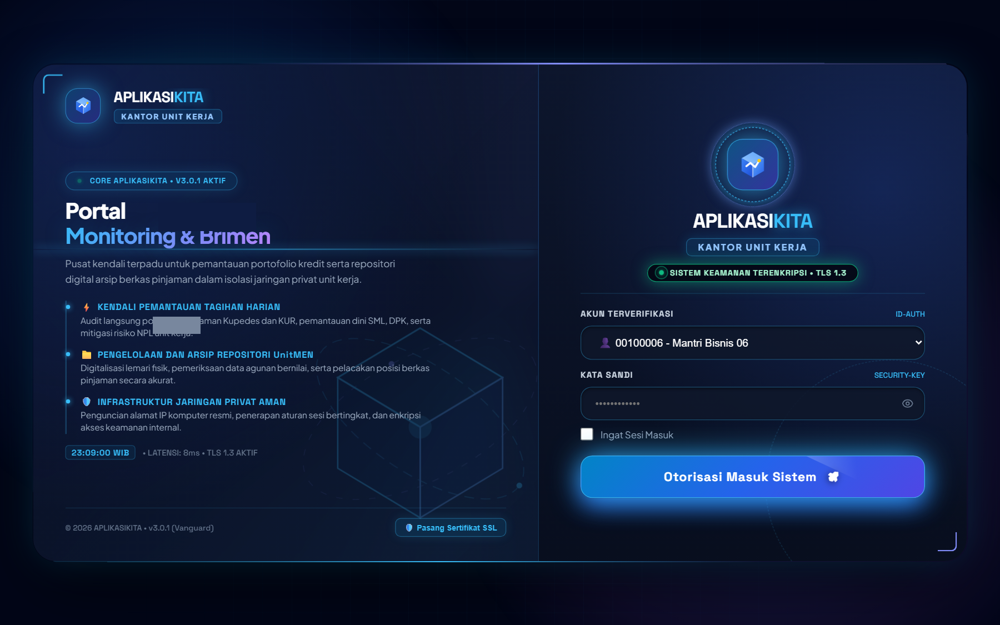
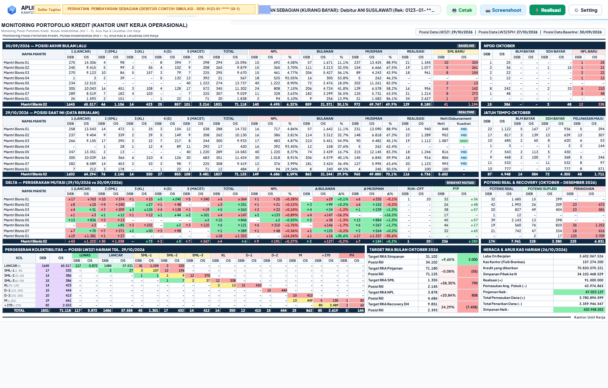
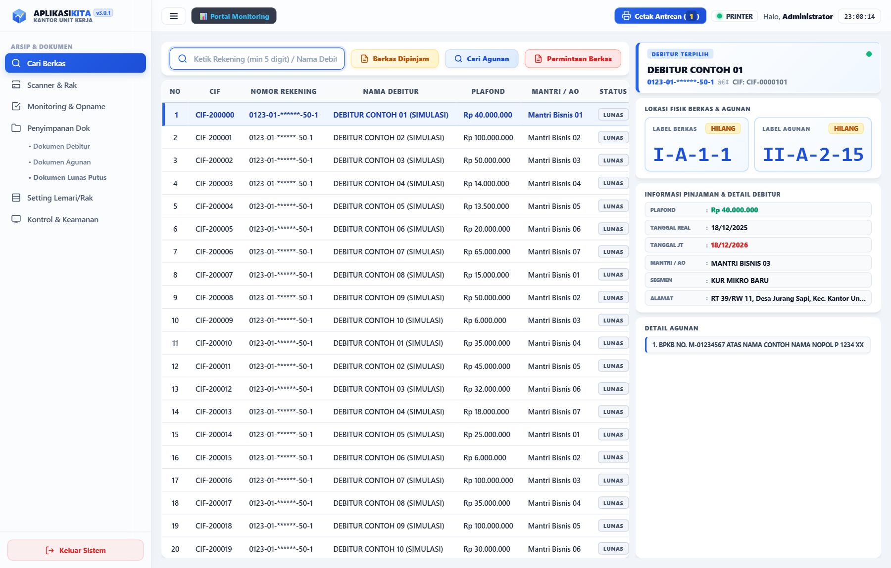
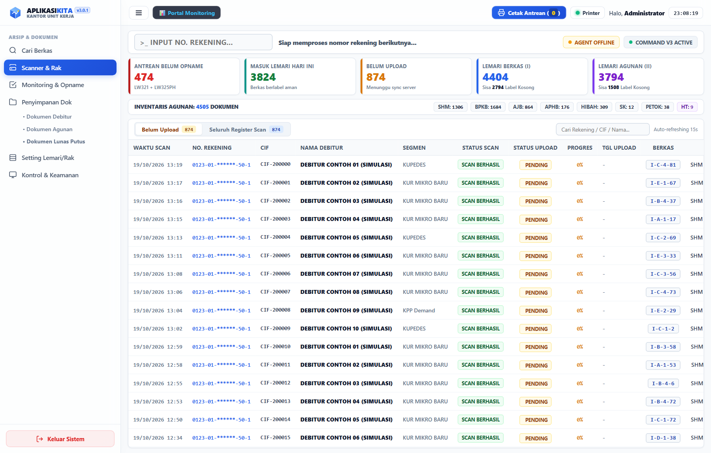
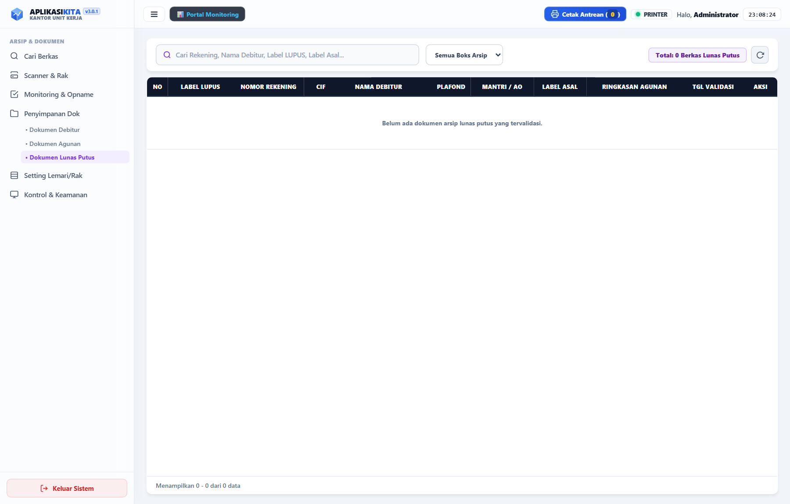
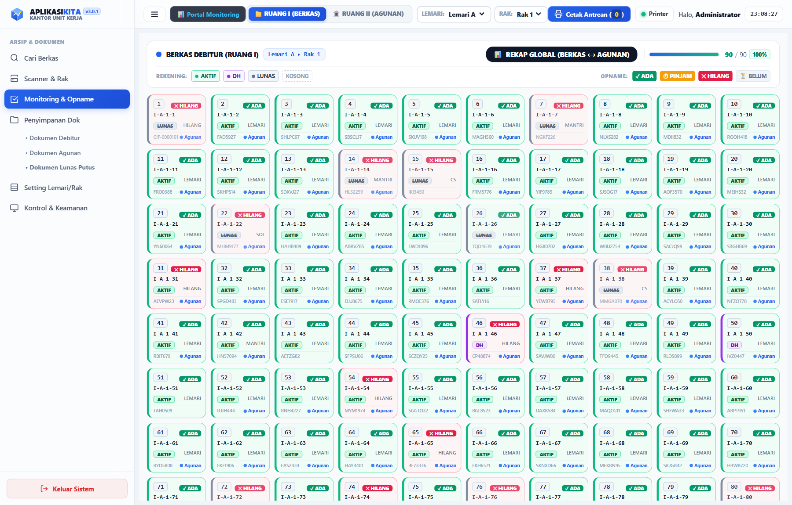
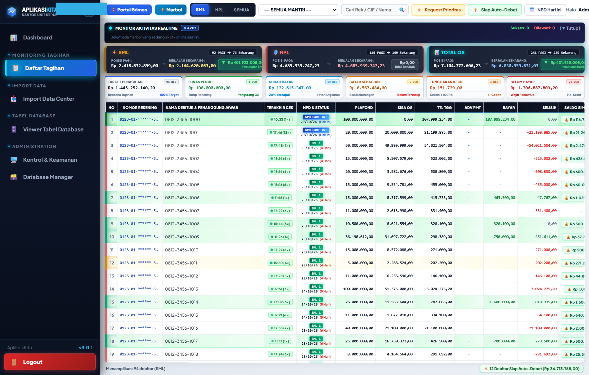
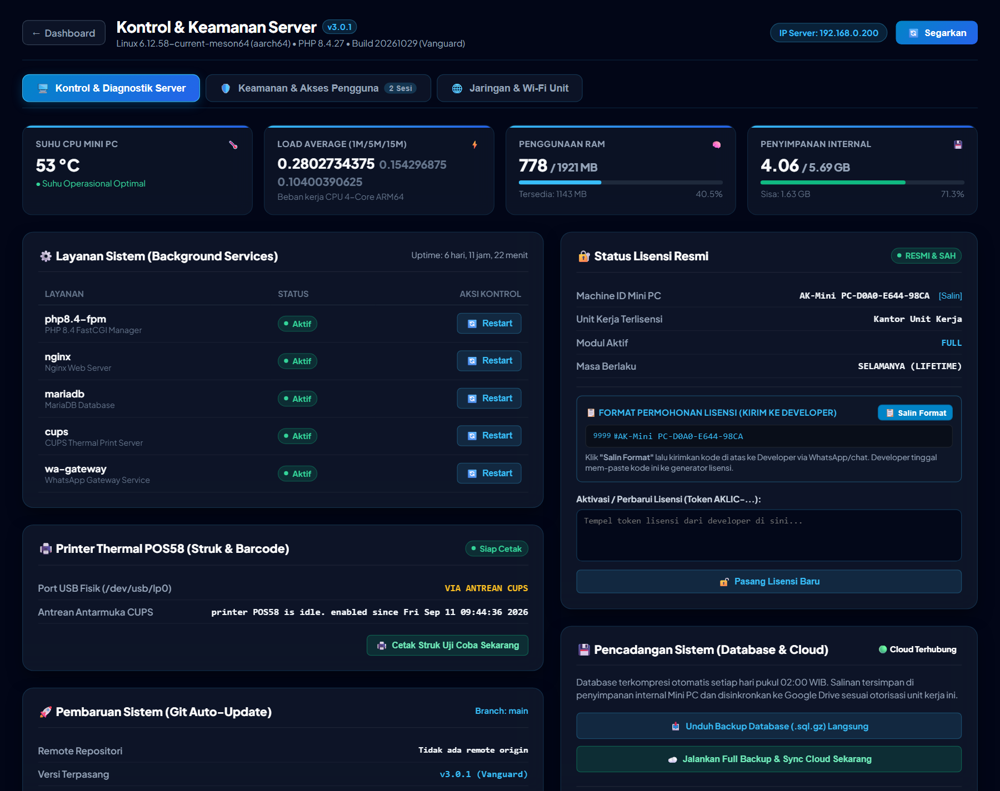
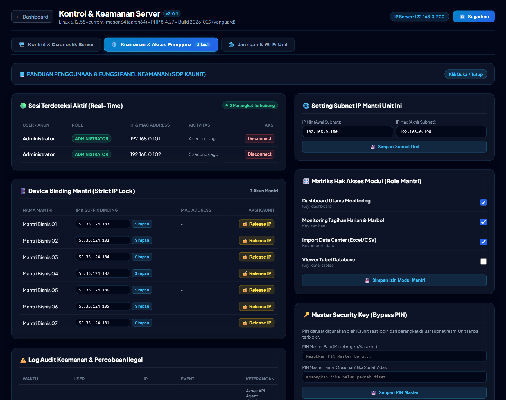
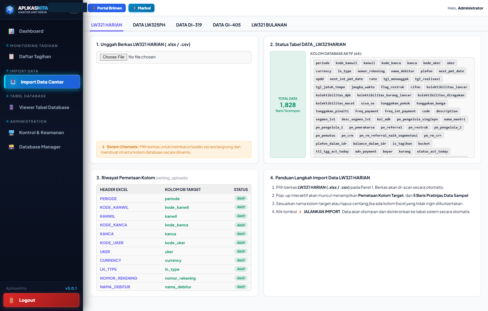

# 🚀 APLIKASIKITA (Platform Operasional Mini PC)

**Platform Digital Tata Kelola Operasional, Monitoring Portofolio Pinjaman & Tata Arsip Digital**  
*Versi:* `AplikasiKita-v3.1.5` | *Codename:* `Vanguard` | *Build:* `#20261031` | *Target Arsitektur:* Multi-Unit Mini PC Linux (Armbian/Debian/Ubuntu ARM64 & x86_64)

---

## 📖 1. Gambaran Umum Sistem

**AplikasiKita** adalah platform operasional internal perbankan berbasis web yang dibangun dengan kerangka kerja modern **Laravel 13** dan runtime **PHP 8.4**. Sistem ini dirancang secara khusus untuk beroperasi mandiri (*offline-first*) di atas perangkat **Mini PC** Linux pada setiap kantor unit kerja operasional.

Aplikasi ini menjamin kelancaran operasional harian kantor unit tanpa ketergantungan koneksi internet publik yang konstan, menyediakan pemantauan komprehensif portofolio debitur secara *real-time*, integrasi tata arsip berkas jaminan digital, pencetakan tanda terima dan label barcode via printer thermal POS58 USB, layanan otomatisasi laporan terjadwal WhatsApp 4 sesi operasional harian, serta pusat kontrol hardware server dan mitigasi keamanan jaringan LAN tingkat tinggi.

Repositori ini berfungsi sebagai **Kanal Distribusi** terpusat untuk mendistribusikan pembaruan sistem secara berkesinambungan (*Pembaruan Otomatis Git*) ke seluruh jaringan perangkat Mini PC yang tersebar di kantor-kantor unit.

---

## ⚙️ 2. Arsitektur & Kebutuhan Server

Untuk menjamin kinerja tinggi, stabilitas 24/7, dan latensi rendah pada lingkungan kantor unit, spesifikasi minimum server Mini PC adalah sebagai berikut:

### A. Spesifikasi Perangkat Keras Minimum
* **Prosesor (CPU)**: Minimum 4-Core ARM64 (Cortex-A53 / Cortex-A55 @ 1.5 GHz+) atau prosesor x86_64 Dual-Core 2.0 GHz+.
* **Memori RAM**: Minimum **2 GB** (Rekomendasi: 2 GB – 4 GB LPDDR3/LPDDR4).
* **Penyimpanan Internal**: Minimum **8 GB** eMMC 5.1 / SSD SATA (Rekomendasi: 16 GB+ dengan ketahanan write tinggi).
* **Konektivitas USB**: 1x Port USB 2.0 untuk integrasi Printer Thermal POS58 direct-attached.
* **Konektivitas Jaringan**: 1x Port RJ45 Ethernet LAN 100/1000 Mbps terhubung ke switch lokal unit kerja.

### B. Perangkat Lunak & Lingkungan Eksekusi
| Komponen / Modul | Versi Minimum | Versi Rekomendasi | Fungsi & Peran Operasional |
| :--- | :---: | :---: | :--- |
| **Sistem Operasi** | Linux Kernel 5.10+ | Armbian 24.x / Ubuntu 24.04 LTS / Debian 12 | Sistem operasi dasar Mini PC (Arsitektur aarch64 / x86_64) |
| **Web Server** | Nginx 1.18.0 | Nginx 1.24.x+ | Akselerasi HTTP/2, reverse proxy FPM, enkripsi TLS 1.3 lokal |
| **PHP Runtime** | PHP 8.2.0 | **PHP 8.4.x (PHP-FPM)** | Eksekutor backend Laravel 13 berkinerja tinggi |
| **Ekstensi PHP Wajib** | - | `php-fpm`, `php-mysql`, `php-mbstring`, `php-xml`, `php-curl`, `php-zip`, `php-bcmath`, `php-intl`, `php-gd` | Pengolah kalkulasi baki debet, kompresi berkas, dan modul grafis |
| **Database Server** | MariaDB 10.6 | **MariaDB 10.11+ / MySQL 8.0** | Database relasional transaksional ACID (Engine InnoDB, utf8mb4) |
| **Headless Runtime** | Node.js v18.0 LTS | **Node.js v20.x LTS** | Runtime otomatisasi tangkapan layar laporan (Pemroses Halaman Web Mandiri) |
| **Layanan Percetakan** | CUPS 2.4.x | CUPS Daemon | Driver antrean cetak thermal USB (`/dev/usb/lp0`) raw protocol |
| **Pencadangan Data** | Rclone v1.60.0 | Rclone v1.66+ | Pencadangan cloud Google Drive modular terisolasi per unit kerja |
| **Manajemen Layanan** | systemd 245+ | systemd 255+ | Watchdog otomatis, restart service gagal, dan penjadwalan cron |

---

## 📸 3. Ikhtisar Antarmuka & Fitur Utama (Versi 3.1.5)

> [!NOTE]
> **Privasi & Sanitasi Data**: Seluruh tangkapan layar antarmuka di bawah ini telah disanitasi dan menggunakan data simulasi/dummy untuk keperluan dokumentasi sistem. Tidak ada data nasabah riil, nomor rekening nyata, maupun kode unit kerja yang ditampilkan.

---

### 🌐 DOKUMENTASI 10 HALAMAN UTAMA

#### 1. Portal Login & Autentikasi Pengguna (`/login`)

- **Tujuan Bisnis**: Pintu gerbang keamanan akses sistem multi-peran (Hak Akses Berbasis Peran) bagi seluruh insan operasional kantor unit.
- **Elemen Antarmuka**:
  - Tampilan *midnight blue glassmorphism* dengan identitas unit operasional dinamis.
  - Pemilih Akun Peran Interaktif: Kepala Unit (Kaunit), Mantri Mikro / Bisnis, Petugas Arsip Digital, Customer Service, Supervisor Layanan Operasional, dan Administrator Sistem.
  - Modul Panduan & Unduh Sertifikat Keamanan SSL untuk browser internal LAN.
  - Proteksi Brute-force & Pembatasan IP Subnet unit kerja (Pembatasan Subnet Jaringan LAN).

---

#### 2. Dashboard Monitoring Portofolio & Kuadran Kredit (`/dashboard`)

- **Tujuan Bisnis**: Pusat kendali eksekutif untuk memantau pergerakan baki debet, debitur menunggak, dan matriks risiko harian secara *real-time*.
- **Elemen Antarmuka**:
  - 8 Indikator KPI Utama: Total Outstanding (OS), DPK Simpanan, Rasio NPL, Rasio Lar, Realisasi Bulanan, Restrukturisasi, dan Efisiensi Operasional.
  - Matriks Kuadran Transisi Portofolio 4-Grid: Memetakan debitur berdasarkan kualitas pembayaran dan penurunan pinjaman.
  - Grafik Distribusi Mantri: Visualisasi kontribusi baki debet per pengelola pinjaman.
  - Tombol aksi cepat: Filter Regional, Realisasi Manual, dan Ekspor Laporan.

---

#### 3. Pencarian Berkas & Manajemen Agunan Fisik (`/cariberkas`)

- **Tujuan Bisnis**: Mesin pencari instan arsip jaminan debitur dengan integrasi peta fisik lemari dan boks penyimpanan unit.
- **Elemen Antarmuka**:
  - Pencarian multi-kriteria: Nomor Rekening, Nama Debitur, Nomor CIF, atau Nomor Agunan (SHM/BPKB).
  - Panel Detail Berkas 360°: Menampilkan riwayat pinjaman, kelengkapan berkas fisik, dan status peminjaman.
  - Peta Lokasi Fisik: Visualisasi lemari, rak, dan boks tempat berkas disimpan.
  - Fitur Permintaan Berkas & Cetak Lembar Peminjaman.

---

#### 4. Scanner Registrasi Barcode Berkas (`/scanner`)

- **Tujuan Bisnis**: Antarmuka berkecepatan tinggi untuk pencatatan dan penataan arsip jaminan baru menggunakan barcode scanner USB.
- **Elemen Antarmuka**:
  - Mode Input Otomatis: Deteksi cepat scan barcode nomor rekening tanpa perlu sentuhan keyboard.
  - Validasi Agunan Seketika: Memverifikasi kesesuaian fisik dokumen dengan basis data sistem.
  - Penempatan Otomatis Slot Lemari: Rekomendasi slot boks kosong terdekat.
  - Riwayat Scan Harian (Tabel Riwayat Langsung): Monitoring daftar berkas yang baru saja diproses secara berurutan.

---

#### 5. Manajemen Berkas Lunas Putus (`/dokumen/lunas-putus`)

- **Tujuan Bisnis**: Tata kelola khusus pengembalian dokumen agunan untuk pinjaman yang telah berstatus lunas penuh.
- **Elemen Antarmuka**:
  - Daftar antrean berkas lunas yang siap diserahkan kepada nasabah.
  - Form verifikasi serah terima agunan lengkap dengan tanda tangan bukti penerimaan.
  - Penandaan status arsip keluar dari lemari penyimpanan unit.
  - Riwayat audit pencatatan tanggal lunas dan petugas penyerah.

---

#### 6. Pengaturan Tata Letak Lemari & Slot (`/monitoring-lemari`)

- **Tujuan Bisnis**: Konfigurasi denah spasial lemari arsip fisik di ruang khazanah unit kerja.
- **Elemen Antarmuka**:
  - Visualisasi Grid Lemari: Representasi grafis setiap lemari, saf, dan boks penyimpanan.
  - Indikator Kapasitas (Tingkat Keterisian): Menampilkan persentase keterisian masing-masing boks secara visual (Warna Hijau, Kuning, Merah).
  - Manajemen Tambah/Hapus Boks dan Penyesuaian Nomor Urut Penyimpanan.
  - Audit Cepat Fisik Boks (Verifikasi Ruang Khazanah).

---

#### 7. Tagihan Harian Mantri & Penurunan OS (`/tagihan`)

- **Tujuan Bisnis**: Instrumen harian pengelola kredit (Mantri) untuk mengeksekusi penagihan debitur menunggak dan memantau penurunan baki debet hari ini.
- **Elemen Antarmuka**:
  - Tabel Daftar Tagihan Dinamis: Nomor rekening rapi (15 digit terstandarisasi), nama nasabah, baki debet, tunggakan pokok, dan bunga.
  - Kalkulasi Penurunan OS Akurat: Pelunasan debitur tercatat murni sebagai penurunan baki debet.
  - Tombol Cetak Struk Tagihan Kasir Thermal POS58 USB.
  - Filter interaktif per Mantri dan per Wilayah Desa/Kelurahan binaan.

---

#### 8. Pusat Kontrol Hardware Mini PC (`/pengaturan/server?tab=server`)

- **Tujuan Bisnis**: Monitoring kesehatan fisik perangkat keras Mini PC dan pengelolaan layanan server terpusat.
- **Elemen Antarmuka**:
  - Telemetri Hardware Real-Time: Penggunaan CPU, konsumsi RAM, suhu processor (°C), dan kapasitas penyimpanan storage.
  - Panel Kontrol Layanan: Status Web Server Nginx, PHP-FPM, Database MariaDB, dan CUPS Printing Daemon.
  - Manajemen Daya & Pemeliharaan: Tombol Reboot Server Aman dan Shutdown Terjadwal.
  - Informasi Versi Terpasang (`v3.1.5 Vanguard`), Hash Komit Terakhir, dan Status Git Auto-Update.

---

#### 9. Keamanan Jaringan & Manajemen IP (`/pengaturan/server?tab=security`)

- **Tujuan Bisnis**: Pengamanan perimeter jaringan lokal LAN kantor unit dan manajemen hak akses nirkabel.
- **Elemen Antarmuka**:
  - Konfigurasi Antarmuka Jaringan: IP Ethernet LAN (Standar Suffix `.197`) dan IP Wi-Fi (Standar Suffix `.200`).
  - Whitelist Akses Nirkabel: Pengaturan 3 slot IP khusus untuk akses perangkat bergerak (Kaunit & Administrator).
  - Monitoring Status Jaringan: Uji latensi gateway lokal dan status koneksi perangkat terhubung.
  - Pengendalian Keamanan Akses: Proteksi otentikasi bertingkat untuk perubahan konfigurasi jaringan.

---

#### 10. Impor & Validasi Data Operasional (`/import`)

- **Tujuan Bisnis**: Fasilitas integrasi data harian portofolio pinjaman dan simpanan dari file laporan perbankan standar.
- **Elemen Antarmuka**:
  - Area Unggah Berkas: Mendukung format CSV, Excel, dan arsip data terenkripsi.
  - Validasi Skema Data Otomatis: Pencegahan inkonsistensi baris dan deteksi duplikasi rekening sebelum komit ke database.
  - Ringkasan Hasil Impor: Jumlah baris berhasil, pergerakan baki debet netto, dan log audit waktu pemrosesan.
  - Perlindungan Integritas Database ACID: Rollback otomatis jika terjadi kegagalan pembacaan baris data.

---

## 📄 4. Hak Cipta & Ketentuan Penggunaan

Hak Cipta © 2026 **AplikasiKita Platform**. Seluruh hak cipta dilindungi undang-undang.  
Perangkat lunak ini bersifat rahasia dan merupakan hak milik terbatas (*Proprietary & Confidential*). Dilarang keras menyalin, mendistribusikan, memodifikasi, atau merekayasa balik tanpa izin tertulis resmi dari pengembang sistem.
